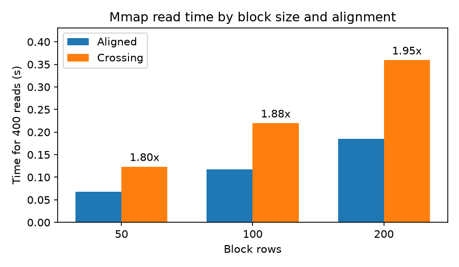
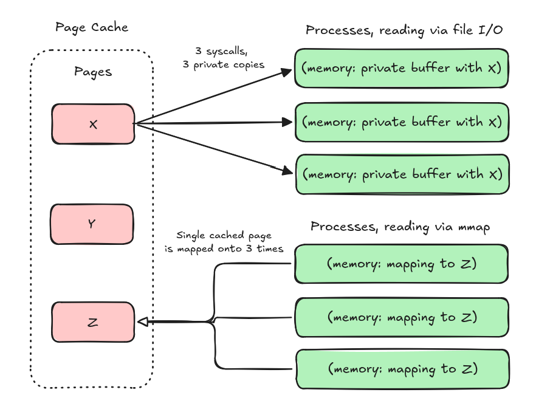

# Out-of-core processing with memory-mapped arrays

## How out-of-core mmap reads work

```python
# Avoid (for read-heavy, scattered access): regular I/O per chunk
arr = blosc2.open(path)

# Prefer: map the file once, read pages directly
arr = blosc2.open(path, mmap_mode="r")
```

## Memory profiling for standard vs. mmap reads

## Modes

The four `mmap_mode` options are:

| `mmap_mode` | Can read? | Can modify in-memory? | Changes saved to file? | Use case |
| --- | --- | --- | --- | --- |
| `"r"` | Yes | No | No | Read an existing file. |
| `"c"` | Yes | Yes | No | Copy-on-write: make purely in-memory changes. |
| `"r+"` | Yes | Yes | Yes | Update or append to an existing file. |
| `"w+"` | Yes | Yes | Yes | Create or overwrite an existing file; specified in constructor. |

Notes:

- the `mmap_mode` argument also overrides the separate `mode` argument.
- `mmap_mode` is only supported for contiguous files.

## Chunk and block sizing for mmap

Arrays in Blosc2 have a double-partition, by which arrays are initially
split into chunks, and those chunks are split into blocks. Blocks are
sized to fit CPU caches, and are the individual units of decompression.
For the same-sized read, decompressing less blocks generally means
less work. With that said, aligning reads with blocks and chunks (as
opposed to having the reads cross boundaries) is good practice.

The [Optimization Tips](https://blosc.org/python-blosc2/guides/optimization_tips.html#align-your-reads-with-the-double-partition) guide benchmarks how
read time is affected by keeping reads aligned to the double-partition.
However, the benchmark was recorded with regular I/O instead of mmap.

For mmap reads, keeping reads aligned still matters. The following chart
shows how crossing blocks increases mmap read time on different block
sizes. It was recorded on an AMD Ryzen™ AI 7 PRO 350 machine, with fixed
sizes for read requests, chunks and the array itself:



In this run, reading across block boundaries leads to a 1.8-2x penalty
in wall time, compared to staying aligned with blocks. The penalty
increases when block size increases. The measured times account for the
combined cost of mapped-file access and decompression work, although it
does not separate them. See mmap_block_locality.py to reproduce.

## Concurrency with mmap

For reading the same Blosc2 file across multiple processes, using
`mmap_mode=r` is recommended. Regular-I/O access leads to each process
copying the OS page cache data for each block read individually,
whereas mmap allows each process to map onto the page cache data and
effectively share the corresponding blocks:



The chart below quantifies this effect. It compares reads with regular
I/O and mmap across 1-8 concurrent readers on the same Apple M4 Pro
machine, 269 MB NDarray, and a warm OS cache. The difference gets
larger as more readers are added:


With 8 concurrent readers, mmap yields ~1.1x faster wall time and 5%
less total CPU. The improvement accounts for regular file I/O requiring
a syscall and buffer copy for every block read. Although the improvement
is modest, this makes mmap a default for concurrent access.

See [Sharing
Containers Across Processes](https://blosc.org/python-blosc2/guides/sharing_across_processes.html#colophon-how-much-does-mmap-help-many-readers) for more details,
and run [`tip_10_mmap_many_readers.py`](https://github.com/Blosc/python-blosc2/blob/main/bench/optim_tips/tip_10_mmap_many_readers.py) to reproduce.
