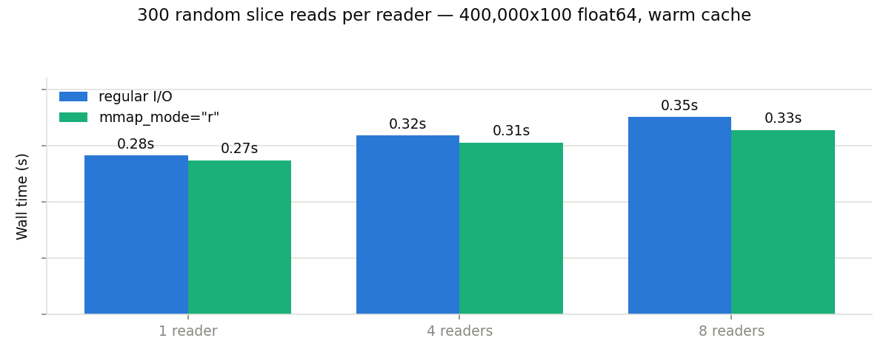

# Out-of-core processing with memory-mapped arrays

## How out-of-core mmap reads work

```python
# Avoid (for read-heavy, scattered access): regular I/O per chunk
arr = blosc2.open(path)

# Prefer: map the file once, read pages directly
arr = blosc2.open(path, mmap_mode="r")
```

## Memory profiling for standard vs. mmap reads

## Modes

Four `mmap_mode` options can be used for memory mapping:

| `mmap_mode` | Can read? | Can modify in-memory? | Changes saved to file? | Use case |
| --- | --- | --- | --- | --- |
| `"r"` | Yes | No | No | Read an existing file. |
| `"c"` | Yes | Yes | No | Copy-on-write: make purely in-memory changes. |
| `"r+"` | Yes | Yes | Yes | Update or append to an existing file. |
| `"w+"` | Yes | Yes | Yes | Create or overwrite an existing file; specified in constructor. |

```{tip}
For `SChunk` and `NDArray`, `mmap_mode` overrides the separate `mode` argument.
`BatchArray`, `CTable` and general data stores (`EmbedStore`, `DictStore`, and
`TreeStore`) support only read-only memory mapping: use `mmap_mode="r"` together
with `mode="r"`. `mmap_mode="r"` with any other `mode` argument leads to a
`ValueError`.
```

```{tip}
Memory mapping requires a path to a contiguous file. To create a mapped file,
use `mmap_mode="w+"` in a constructor; `blosc2.open(..., mmap_mode="w+")` raises
`ValueError`.
```

## Chunk and block sizing for mmap

Arrays in Blosc2 have a double-partition, by which arrays are initially
split into chunks, and those chunks are split into blocks. Blocks are
sized to fit CPU caches, and are the individual units of decompression.
For the same-sized read, decompressing less blocks generally means
less work. With that said, aligning reads with blocks and chunks (as
opposed to having the reads cross boundaries) is good practice.

The [Optimization Tips](optimization_tips.md#align-your-reads-with-the-double-partition) guide benchmarks how
read time is affected by keeping reads aligned to the double-partition.
However, the benchmark was recorded with regular I/O instead of mmap.

For mmap reads, keeping reads aligned still matters. The following chart
shows how crossing blocks increases mmap read time on different block
sizes. It was recorded on an AMD Ryzen™ AI 7 PRO 350 machine, with fixed
sizes for read requests, chunks and the array itself:


In this run, reading across block boundaries leads to a 1.8-2x penalty
in wall time, compared to staying aligned with blocks. The penalty
increases when block size increases. The measured times account for the
combined cost of mapped-file access and decompression work, although it
does not separate them. See [`mmap_block_locality.py`](https://github.com/Blosc/python-blosc2/blob/main/bench/mmap_block_locality.py) to reproduce.

## Concurrency with mmap

Blosc2 supports these situations when sharing a file across processes:

| Situation | Access pattern | Mechanism | Availability | Mmap support |
| --- | --- | --- | --- | --- |
| Concurrent read-only readers | Multiple processes read an unchanged file | No coordination needed | Default | Yes |
| SWMR (single writer, multiple readers) | One process writes while others follow changes | Readers re-sync on access or with `refresh()` | Default | Not recommended |
| Locking | Multiple coordinated writers or readers | Sidecar file locks coordinate operations | Optional | No |

Memory-mapped readers do not follow mutations to container metadata reliably,
and so memory-mapping should be used cautiously with SWMR. Growth is one
example of this: Blosc2's `refresh()` function (for refreshing cached
container state) does not extend mappings to cover newly appended bytes.
In addition, memory-mapping cannot be combined with locking. See [Sharing Containers Across Processes](sharing_across_processes.md) for more details on concurrency options.

```{tip}
Passing `locking=True` with `mmap_mode` raises `ValueError`, while the
global variable `BLOSC_LOCKING` is ignored for mapped containers.
```

For concurrent read-only access, `mmap_mode="r"` is recommended.
Regular-I/O access leads to each process copying the OS page cache data
for each block read individually, whereas mmap allows each process to
map onto the page cache data and effectively share the corresponding
blocks:


The chart below quantifies this effect. It compares reads with regular
I/O and mmap across 1-8 concurrent readers on the same Apple M4 Pro
machine, an unchanged 269 MB NDarray, and a warm OS cache. The
difference gets larger as more readers are added:



With 8 concurrent readers, mmap yields ~1.1x faster wall time and 5%
less total CPU. The improvement accounts for regular file I/O requiring
a syscall and buffer copy for every block read. Although the improvement
is modest, this makes mmap a default for concurrent read-only access.

See [Sharing
Containers Across Processes](sharing_across_processes.md#colophon-how-much-does-mmap-help-many-readers)
for more details, and run [`tip_10_mmap_many_readers.py`](https://github.com/Blosc/python-blosc2/blob/main/bench/optim_tips/tip_10_mmap_many_readers.py) to reproduce.

```{note}
When comparing reader memory, we typically compare RSS (RAM occupied by
the process) and USS (RAM unique to the process). RSS counts mapped file
pages that the process has touched, but does not count page cache entries
for file I/O. This makes regular I/O readers appear much slimmer than
mmap readers. Alongside RSS, consider USS: in multi-reader examples, USS
is nearly identical for both regular and mapped access.
```
